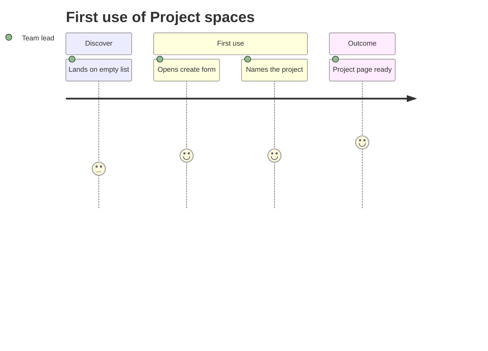

# FEAT-001 — Project spaces

**Job.** As a team lead, when new work starts, I want a named shared space
so that tasks and people have one home.

## Discovery

First visit lands on the projects list (SCR-001). Empty state carries the
feature itself: «Пока нет проектов» + primary button «Создать проект» —
the first thing a new user can do is the core action.

## First-use journey — end to end

| # | Screen | User does | User sees |
|---|--------|-----------|-----------|
| 1 | SCR-001 | opens TeamBoard | empty list, «Создать проект» |
| 2 | SCR-002 | clicks «Создать проект» | name form, focus in field |
| 3 | SCR-002 | types name, submits | validation (empty name → inline error) |
| 4 | SCR-003 | — | project page: title, members block, success note |

Three clicks from cold start to a created project.

## Repeat use

List on SCR-001 grows; the create button moves from empty-state hero to a
regular header action. Last-opened project is the expected landing (open
question below).

## Intersections

| With | Shared | Kind | Resolution |
|------|--------|------|------------|
| FEAT-002 | SCR-003 | screen | SCR-003 is owned by Project spaces (title, layout); Team invitations owns the members block and its «Пригласить» action. Creation success note must not cover the invite control — invite is the expected next step. |

## Visual

## Decomposition

| Story | Scope (one line) |
|-------|------------------|
| US-001 | Create a project: form, empty-name error, success landing |

## Open questions

- Should a returning user land on the list or the last-opened project?
