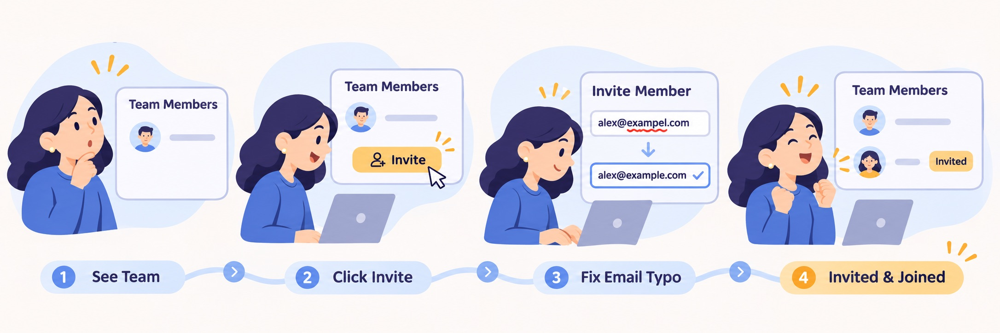
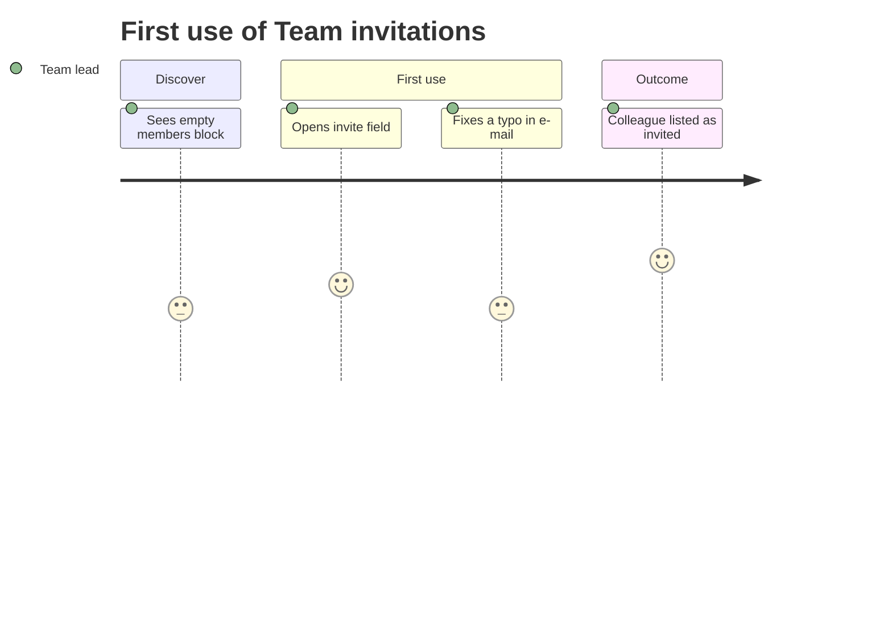

# FEAT-002 — Team invitations

**Job.** As a team lead, when a project exists, I want colleagues inside it
so that the board reflects the real team.

## Discovery

The members block on the project page (SCR-003) starts with just the owner
and a visible «Пригласить» action — the empty team itself is the prompt.
No separate settings page to find.

## First-use journey — end to end

| # | Screen | User does | User sees |
|---|--------|-----------|-----------|
| 1 | SCR-003 | lands after creating a project | members block: owner + «Пригласить» |
| 2 | SCR-003 | clicks «Пригласить» | e-mail field with focus |
| 3 | SCR-003 | enters e-mail, submits | invalid → inline error with example; valid → row added, status «приглашён» |

One screen, two clicks — invitation never leaves the project context.

## Repeat use

Repeat invites from the same control; duplicate e-mail answers with a calm
notice («уже в проекте — приглашение не требуется»), not an error tone.
Statuses in the member list are the passive surface of the feature.

## Intersections

| With | Shared | Kind | Resolution |
|------|--------|------|------------|
| FEAT-001 | SCR-003 | screen | Project spaces owns the page; invitations own the members block. The creation success note and the invite form must coexist — invite stays reachable while the note is visible. |

## Visual

## Decomposition

| Story | Scope (one line) |
|-------|------------------|
| US-002 | Invite flow: e-mail validation, duplicate guard, status «приглашён» |

## Open questions

- Re-send invitation for a stuck «приглашён» status — needed in v1?
