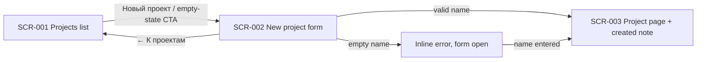

# FLOW-001 — Create a project

## Steps and cost
| # | Screen | User does | Clicks from entry |
|---|--------|-----------|-------------------|
| 1 | SCR-001 | presses create | 1 |
| 2 | SCR-002 | types name, submits | 2 |
| 3 | SCR-003 | sees result + next action | 2 |

## Recovery paths
- Empty name → inline error, input kept (F1).
- Back link on the form abandons creation without side effects.
