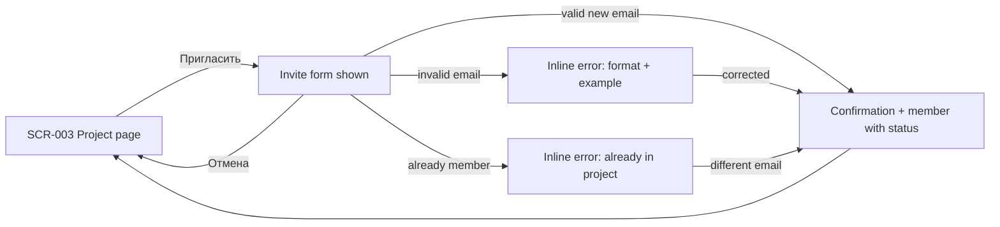

# FLOW-002 — Invite a colleague

## Steps and cost
| # | Screen | User does | Clicks from entry |
|---|--------|-----------|-------------------|
| 1 | SCR-003 | opens invite form | 1 |
| 2 | SCR-003 | types email, submits | 2 |
| 3 | SCR-003 | sees confirmation and status in list | 2 |

## Recovery paths
- Both failure edges return to the open form with input preserved.
- Cancel closes the form with no side effects (A2).
- Invitation status stays visible in the members list after the flow.
