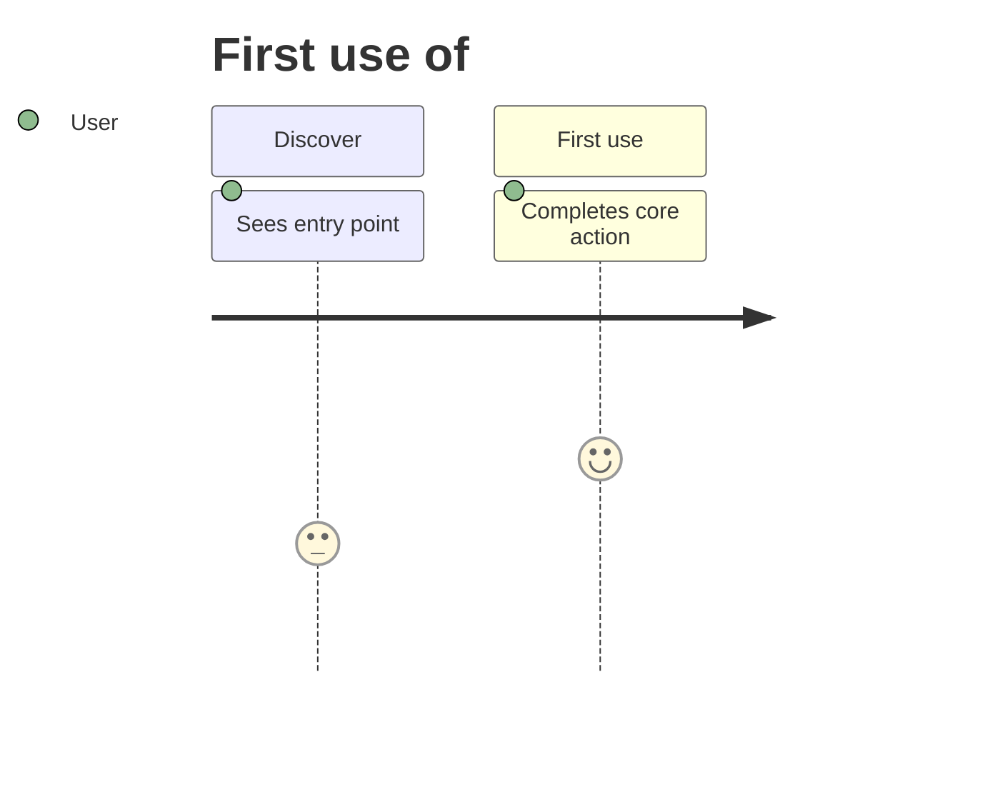

# FEAT-000 — <title>

**Job.** As a <persona>, when <situation>, I want <capability> so that <outcome>.

## Discovery

How the user learns this feature exists: which surface shows it first
(button, empty state, onboarding hint, notification), and what makes them
try it the first time.

## First-use journey — end to end

| # | Screen | User does | User sees |
|---|--------|-----------|-----------|
| 1 | SCR-000 | … | … |

The journey starts at app entry, not at the feature's own screen. Count the
clicks; a first use that takes more than ~5 steps needs a shortcut or a
better entry point — note it in Open questions.

## Repeat use

What changes on the Nth use: remembered defaults, shortcuts, bulk paths,
where the feature surfaces passively (badges, statuses, lists).

## Intersections

| With | Shared | Kind | Resolution |
|------|--------|------|------------|
| FEAT-000 | SCR-000 | screen / data / control / concept | who wins the space, how both stay discoverable |

Every screen shared with another feature MUST appear here, and the other
feature must list this one back (`intersects` is mutual — the validator
enforces both).

## Visual

## Decomposition

| Story | Scope (one line) |
|-------|------------------|
| US-000 | … |

## Open questions

- …
